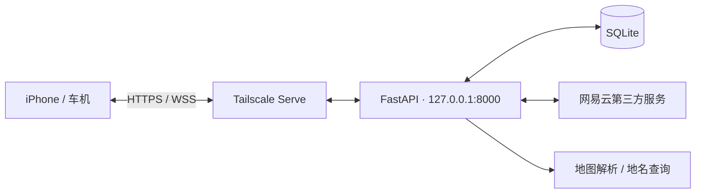

<div align="center">

# ⚙️ MyYaris · Backend

**连接手机、车机与持久化任务**


[项目总览](https://github.com/JamesXiaoMo/MyYaris) · [iPhone 客户端](https://github.com/JamesXiaoMo/MyYaris-iOS) · [API 参考](docs/API参考.md)

</div>

---

运行于 Linux 边缘宿主机的 FastAPI 服务，使用 SQLite 持久化用户、地址收藏、导航任务和音乐控制指令。通过 Tailscale Serve 提供 Tailnet 内的 HTTPS 入口。

## 核心模块

| 模块 | 职责 |
| --- | --- |
| 账户 | 用户名与密码登录、Argon2id 密码哈希、会话、头像及设备授权。 |
| 导航 | 解析经纬度、Plus Code 和地图链接；歧义澄清、候选确认、任务分发和回执。 |
| 收藏 | 用户地址及 WGS84 坐标的数据库保存与维护。 |
| 音乐 | 搜索、流媒体转发/缓存、“我喜欢的音乐”分页读取与歌单归属校验。 |
| 设备控制 | WebSocket 与 HTTP 轮询、指令有效期、幂等处理和状态同步。 |



## 本地启动

```bash
python3 -m venv .venv
source .venv/bin/activate
pip install -r requirements.txt
cp .env.example .env
```

启动前编辑 `.env`，配置独立设备凭据、账户认证和所需的外部服务。示例不包含生产凭据。

```bash
uvicorn app.main:app --host 127.0.0.1 --port 8000
```

- 健康检查：`GET /health`
- Swagger：`http://127.0.0.1:8000/docs`
- 自动化测试：`.venv/bin/pytest`
- 部署文件与说明：[deploy/](deploy/)
- 管理员初始化工具：[tools/init_admin.py](tools/init_admin.py)，在服务器交互执行并自行输入密码。

## 接口与架构文档

- [API 参考](docs/API参考.md)
- [账户 API 与迁移方案](docs/用户账户API与迁移方案.md)
- [后端架构说明](docs/后端当前架构.md)
- [网易云喜欢歌单说明](docs/网易云喜欢歌单接入可行性.md)
- [三端共享契约](https://github.com/JamesXiaoMo/MyYaris/blob/main/docs/API-V2三端契约.md)

“我喜欢的音乐”接口：`GET /api/v1/music/netease/playlist/favorite?offset=0&limit=30`。具体权限、响应字段和异常码以 API 参考为准。

## 运行边界

- Tailscale Serve 的当前方案只在 Tailnet 内可达，客户端保留 HTTPS 证书验证。
- 手机使用账户会话；车机设备凭据独立管理，旧 Token 仅按迁移配置兼容。
- 地图分享链接不一定包含精确坐标；不明确的候选需要确认。
- `launch_requested` 表示请求打开导航；指令回执不单独证明导航开始或音乐实际出声。
- 网易云接口依赖第三方实现，不是网易云官方公开 API；可播放性受登录、权限、版权和网络条件影响。
- 语音及 AI 供应商接口的存在不代表已部署可用模型。

## 仓库维护

改动完成并通过必要检查后，在本仓库提交并推送 GitHub。不上传 `.env`、Cookie、密码、数据库、音乐缓存或运行日志。历史验证记录不代表当前设备在线状态。
