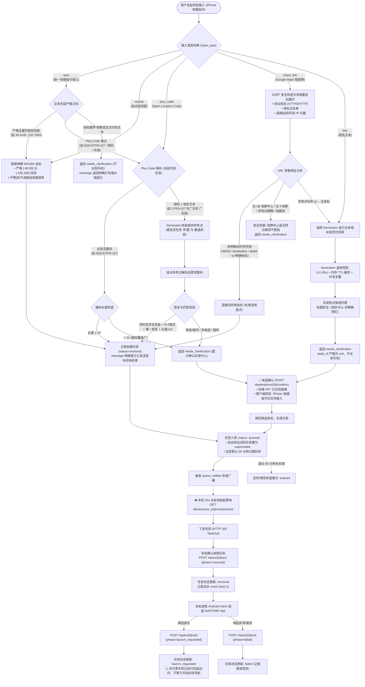

# MyYaris 后端当前架构与数据处理流程

本文档详细记录 MyYaris 导航后端的当前实际技术架构、部署拓扑、数据处理管线、任务状态机及各功能模块的落地状态。

---

## 零、前序 Google 分享链接研究结论摘要

在针对 Google Maps 分享链接（以 `https://maps.app.goo.gl/EXAMPLE 为例）的调研与复现验证中，得出以下核心结论与事实边界：

1. **载荷特征与已知/未知边界**：
   - **已验证事实**：该短链展开后，HTTP 重定向载荷中包含 `q=Saijocho Jike, 东广岛市广岛县 739-0041&ftid=0x35506fe1f7b9c61b:0xf88f7f99ef5d58cd`，首屏静态 HTML 与 URL 参数中均未提取到 `!3d!4d` 等显式目的地图钉字段。
   - **推断与未知界限**：上述参数特征表明该链接指向广域行政区划实体；但网络重定向载荷仅代表数据包属性，**既不能证明用户手机界面的具体触控手势，也不能证明客户端后续动态 JS/RPC 请求中是否存在其他关联数据**。后端严格仅就静态载荷中未携带目的地图钉这一可验证事实进行防御。
2. **S2 几何中心并非 POI 坐标**：
   `ftid` 前半段 `0x35506fe1f7b9c61b` 经 S2 算法解码为 Level 30 叶子网格（`34.42450442, 132.70833243`），网格自身几何误差仅 6.6 毫米；但物理核查显示该点仅为 Google 内部赋予该行政区域的几何锚点（位于与八本松交界处的边缘荒地）。开源项目 OsmAnd 源码注释中明确声明 *`"NOT necessarily the POI coordinate"`*，并在解析时打标 `impreciseCoordinates = true`。作为空间参照，该点与西条町寺家内的实际 POI（如 Lawson 便利店 Plus Code `8Q6JCPF8+Q7`）偏离达 675 米（此对比仅用于说明同名区域内不同设施的空间发散，并非推断用户意图前往该便利店）。
3. **页面抓取极其脆弱**：
   普通 UA 仅能抓取到大范围相机视窗中心（1.1 公里偏差）；仅社交爬虫 UA 能获取带标记的 StaticMap 图像（与 S2 锚点相近），但依赖不可控的内嵌临时签名，且依然只是行政区中心。
4. **结论归宿**：
   **S2 解码与页面抓取仅作为离线可行性调研与实验，未上线生产链路**。生产后端严格保持“不猜坐标、必须确认”的安全防御策略。

---

## 一、系统整体运行与网络架构 (System Architecture)

系统基于 Linux R9000P 宿主机常驻，依托 Tailscale 构建点对点私有加密网络，实现外出 iPhone 快捷指令与车载 Ottocast P3 Pro 盒子的双向安全互通。

```mermaid
flowchart TD
    subgraph ClientLayer ["客户端层 (Tailnet 节点)"]
        iPhone["📱 iPhone (iOS 快捷指令)<br/>• 角色: phone_client<br/>• 凭据: PHONE_TOKEN<br/>• 现状: 仅手动提交并展示原始结果<br/>• 候选确认: 后端 API 已实现，快捷指令端交互待接入"]
        P3Pro["🚘 Ottocast P3 Pro (车机 Flutter 端)<br/>• 角色: car_client (car_p3pro)<br/>• 凭据: CAR_TOKEN<br/>• 动作: 20s 长轮询拉取任务 / 状态三阶段 Ack"]
    end

    subgraph TailscaleNetwork ["安全传输层 (Tailscale 私网)"]
        TS_Serve["🔐 Tailscale Serve (HTTPS 入口)<br/>• 统一私网域名: *.ts.net:443<br/>• 自动证书管理 (TLS 终结)<br/>• 反向代理至本地: 127.0.0.1:8000"]
    end

    subgraph HostSystem ["部署与宿主环境 (Linux R9000P)"]
        SystemdUser["⚙️ User Systemd 服务 (myyaris.service)<br/>• 常驻保活: loginctl linger (myyaris-user)<br/>• 崩溃自启: Restart=always (3s)<br/>• 进程: Python 3.12 虚拟环境 uvicorn"]
        
        subgraph FastAPIServer ["FastAPI 核心服务 (127.0.0.1:8000)"]
            AuthMod["🛡️ 认证与权限校验 (app/api/auth.py)<br/>• Bearer 令牌解析<br/>• 角色隔离 (phone / car / admin)<br/>• 设备绑定防越权"]
            DestRouter["📍 目的地路由 (/destinations)<br/>• 幂等校验<br/>• 链接/PlusCode/坐标/地名解析<br/>• 候选确认接口 (API已就绪)"]
            TaskRouter["📋 任务路由 (/devices, /tasks)<br/>• 长轮询挂起 (Next Task)<br/>• 状态单调回执 (Ack)"]
            VoiceRouter["🎙️ 语音路由 (/voice)<br/>• 文件校验与暂存 (骨架)"]
            
            QueueNotifier["⚡ 异步事件通知器 (queue_notifier)<br/>• 基于 asyncio.Event<br/>• 新任务下发毫秒级唤醒轮询协程"]
        end

        subgraph StorageLayer ["存储层 (本地持久化)"]
            SQLiteDB[("💾 SQLite 数据库<br/>~/.local/share/myyaris/myyaris.db<br/>• parse_requests (请求历史与幂等键)<br/>• candidates (地点候选)<br/>• tasks (任务主表与状态)<br/>• task_events (审计回执流水)")]
        end
    end

    subgraph ExternalServices ["外部与待评估地图能力"]
        OSM_Nominatim["🌐 OpenStreetMap Nominatim (当前唯一接入)<br/>• 规范化检索日本 47 都道府县<br/>• 开源数据: 不保证新店实时更新或车行入口<br/>• 合规硬限制: 1.05s 速率 + 24h 内存缓存"]
        PendingGIS["⏳ 待评估数据源 (当前代码未接入)<br/>• 国土地理院 GSI 地理 API<br/>• Overpass 高级要素查询<br/>• 车机 NAVITIME 本地 POI 库"]
    end

    subgraph CarSystem ["车载端执行"]
        NAVITIME["🗺️ NAVITIME Android App<br/>• 经 Flutter Intent 调用唤起<br/>• ⚠️ launch_requested 仅代表 App 调起意图<br/>• 不等于实际路线导航开始"]
    end

    iPhone -->|HTTPS POST| TS_Serve
    P3Pro -->|HTTPS GET/POST (长轮询/Ack)| TS_Serve
    TS_Serve -->|HTTP 127.0.0.1:8000| FastAPIServer
    
    DestRouter --> AuthMod
    TaskRouter --> AuthMod
    VoiceRouter --> AuthMod

    DestRouter --> SQLiteDB
    TaskRouter --> SQLiteDB
    TaskRouter <--> QueueNotifier
    DestRouter --> QueueNotifier
    
    DestRouter -.->|地名兜底检索 (合规限流)| OSM_Nominatim
    P3Pro -->|Android Intent 唤起| NAVITIME
```

---

## 二、数据处理与任务生命周期流程 (Data Processing Flow)

后端坚持**“不猜坐标、防 SSRF、二阶段确认、单调状态流转”**的核心设计。



---

## 三、核心模块与关键机制详细核实

### 1. 身份认证与安全隔离 (app/api/auth.py)
- **实现机制**：HTTP `Authorization: Bearer <TOKEN>` 统一头校验。
- **角色分配**：
  - `phone_client`（持有 `PHONE_TOKEN`）：仅允许提交目的地解析（`POST /destinations`）、确认候选（`POST /destinations/{id}/confirm`）。
  - `car_client`（持有 `CAR_TOKEN`）：绑定单设备标识 `car_p3pro`，仅允许拉取本人设备的任务（`GET /devices/car_p3pro/tasks/next`）与提交回执（`POST /tasks/{id}/ack`），严禁跨设备越权。
  - `admin`（持有 `ADMIN_TOKEN`）：超级管理角色，具备全部接口权限。
- **硬安全策略**：若服务器 `.env` 未配置令牌，直接响应 `503 Service Unavailable` 拒绝提供服务；令牌严格私有存储（权限 `0600`），绝不向外暴露。

### 2. 请求幂等性控制 (Semantic Idempotency)
- **请求阶段**：客户端传入 `idempotency_key`。若发现相同 `caller_id` 与键名存在：
  - 比对输入载荷（Payload）。若完全一致，直接返回历史 `ParseRequest` 结果；
  - 若载荷不一致，返回 `HTTP 409 Conflict` 阻击参数冲突篡改。
- **确认阶段**：`POST /destinations/{id}/confirm` 执行幂等防护。若该请求已生成过 `task_id`，直接重入返回既有任务，防止重复生成多个并发任务干扰车机。

### 3. Nominatim 限流、缓存与并发去重 (app/providers/nominatim_provider.py)
- **合规速率限制**：内置单例 `NominatimRateLimiter`，强制保证对 OpenStreetMap 官方接口的访问间隔 $\ge 1.05\text{s}$，杜绝被封禁 IP。
- **本地 TTL 缓存**：以 `(地名, lat, lon)` 构建缓存键，配置 24 小时内存缓存（`NOMINATIM_CACHE_TTL_SECONDS=86400.0`），规避相同地名频繁外呼。
- **并发防击穿（In-flight Deduplication）**：对正在进行中的相同查询注册 `asyncio.Future`，多个并发协程共享单次网络 I/O。
- **地址规范化**：内置日本 47 都道府县及常见假名/汉字映射引擎（如“东广岛市” $\to$ “東広島市”），提升海外搜索准确度。

### 4. 任务生命周期与单调状态流转 (app/services/task_service.py)
- **状态集合**：`queued`（排队） $\to$ `received`（车机已取走） $\to$ `launch_requested`（车机已调起） / `failed`（失败） / `expired`（超时） / `superseded`（被覆盖）。
- **任务替代机制（Superseded）**：车机同一时刻仅服务一个目的地。当新任务入库时，数据库内所有仍处于 `queued` 或 `received` 的历史未终结任务立即自动流转为 `superseded`，指向新任务 ID。
- **任务过期机制（Expired）**：默认生存期 60 分钟（`TASK_DEFAULT_EXPIRY_MINUTES=60`），每次拉取或入库时执行惰性扫描更新。
- **三阶段回执与重要边界**：
  - `received`：车机长轮询取到数据时的 ACK。
  - `launch_requested`：车机端向 Android 发起调起 NAVITIME Intent 时的 ACK。**【明确声明】该状态仅代表已尝试拉起第三方 App，由于 NAVITIME 无逆向数据回传协议，不代表已规划路线或已经开始行车导航**。
  - `failed`：车机缺少应用包名、Intent 拒绝或格式非法时的 ACK。
  - 状态流转单调不可逆，终态后拒绝对向覆盖。

### 5. 系统持久化与常驻部署
- **服务配置**：User Systemd 服务 `~/.config/systemd/user/myyaris.service`。
- **会话持久化**：已开启 `loginctl enable-linger myyaris-user`，即使 SSH 终端退出或无物理桌面会话，uvicorn 依然在后台 7×24 小时运行。
- **网络服务**：`tailscale serve --bg http://127.0.0.1:8000` 将私网 HTTPS 请求转发到本地 8000 端口。

### 6. iPhone 快捷指令统一输入模式 (input_type="auto") 与人机反馈规范
- **统一入口背景**：为降低 iPhone 快捷指令的配置与判断复杂度，`POST /destinations` 新增 `input_type="auto"`，统一接收剪贴板或用户输入的单段纯文本（`text` 字段），默认下发目标设备为 `car_p3pro`。
- **严格经纬度解析规则 (`parse_strict_coordinates`)**：
  - 格式限定：支持全角/半角逗号、空格、换行分隔的严格全串匹配 `^\s*([+-]?\d+(?:\.\d+)?)\s*(?:[,，\s]|\r?\n)\s*([+-]?\d+(?:\.\d+)?)\s*$`。
  - 数值校验：浮点必须有限（`math.isfinite`），范围严格限制为纬度 $\in [-90, 90]$、经度 $\in [-180, 180]$。
  - 防乱猜防御：严禁从杂乱文本或复杂 URL 中随意提取两个数字；纬度超界（如 `132.7083, 34.4245`）严格判定为无效，**绝对不自动猜测或调换经纬度顺序**，直接返回 `needs_clarification` 并附带顺序提示。
- **Plus Code 统一分支**：
  - 完整码（$\ge 10$ 位，如 `8Q6JCPF8+Q7`）直接解析为高精度网格中心并下发任务；
  - Google 复制的短码+市县（如 `CPF8+Q7 东广岛市 广岛县`）在满足严格唯一市县校验下自动解析并下发；
  - 粗码（$< 10$ 位）或缺县短码一律返回 `needs_clarification`，不直接派发。
- **人机反馈消息字段 (`message`)**：
  - `DestinationQueryResponse` 顶层新增 `message` 字符串字段，专供 iPhone 快捷指令以系统通知或弹窗呈现。
  - 任务创建成功时：格式明确为 `已成功解析坐标 [纬度 ..., 经度 ...]，任务已发送到车机待处理。` 或 `已成功解析「...」，任务已发送到车机待处理。`，**严格杜绝“已开始导航”等虚假语义**。
  - 需要澄清时：格式如 `未能识别有效目的地...请检查后重新输入。` 或明确指出越界/调换问题。

---

## 四、功能模块落地状态总览

| 模块 / 能力项 | 当前代码与实现状态 | 落地位置 | 备注说明 |
| :--- | :---: | :--- | :--- |
| **快捷指令统一输入 (auto)** | **已实现** | `app/services/destination_service.py` | 支持纯文本经纬度与 Plus Code 严格解析，不乱猜、不盲派 |
| **人机反馈语义消息 (message)** | **已实现** | `app/schemas/destination.py` | 统一响应返回清晰状态文案，准确声明“已发送到车机待处理” |
| **显式经纬度直接下发** | **已实现** | `app/services/destination_service.py` | 直接入库生成 Task 下发车机 |
| **Google 分享链接防猜坐标解析** | **已实现** | `app/providers/google_maps_parser.py` | 逐跳 SSRF 防御；`/@` 与 `ll` 仅作视野中心（不作目的地图钉）；路线起点杜绝防猜 |
| **Plus Code 完整码/短码解析** | **已实现** | `app/providers/plus_code_parser.py` | 长度≥10 完整码或满足“4+2短码+同时含市县+唯一恢复”自动派发；粗码(<10位)或缺市县一律需澄清确认 |
| **Nominatim 日本地名检索兜底** | **已实现** | `app/providers/nominatim_provider.py` | 47 都道府县规范化、1.05s 限流、24h 缓存；开源社区数据不保证新店实时更新或车行入口绝对精度 |
| **两阶段安全确认流 (后端 API)** | **已实现** | `POST /destinations/{id}/confirm` | 后端已就绪；当前 iPhone 快捷指令仅展示原始响应，交互式确认 UI 待客户端接入 |
| **车机 20s 挂起长轮询** | **已实现** | `app/services/task_service.py` | `queue_notifier` 毫秒级异步唤醒，超时 204 |
| **车机三阶段单调回执流水** | **已实现** | `app/repositories/models.py` (`TaskEvent`) | `received` / `launch_requested` / `failed` 审计日志 |
| **任务过期与新任务覆盖替代** | **已实现** | `app/services/task_service.py` | 60 分钟过期、`superseded` 覆盖 |
| **多角色 Bearer 认证与防越权** | **已实现** | `app/api/auth.py` | `phone` / `car` 凭据隔离与权限边界 |
| **Tailscale 私网 HTTPS 常驻** | **已实现** | `myyaris.service` + Tailscale Serve | R9000P 用户级 systemd 生产守护已上线 |
| **S2 几何中心反解** | **仅离线实验** | `scratch/TestOsmAndS2.java` | 经实验证实仅为区域内部多边形锚点，**未上线生产** |
| **社交爬虫 OpenGraph 逆向抓取** | **仅离线实验** | 实验脚本验证 | 依赖不稳定临时签名且坐标仍为区域中心，**未上线生产** |
| **本地 Whisper 语音听写 (ASR)** | **未实现 / 未接入** | `app/providers/provider_factory.py` | 仅保留接口契约，当前抛出 `ProviderNotConfiguredError` |
| **LLM 意图识别与复杂实体抽取 (NLP)** | **未配置 (降级运行)** | `app/services/destination_service.py` | 未配置时优雅降级为原始关键词直接搜索 |
| **NAVITIME 导航中实时状态回传** | **未实现** | 车载前端 / 第三方协议限制 | `launch_requested` 仅为 Intent 唤起意图，无法逆向监听 |
| **国土地理院 GSI / Overpass / NAVITIME本地库** | **待评估 (未接入)** | 规划与可行性评估阶段 | 当前后端未接入，仅作未来多源地图扩展备选 |

