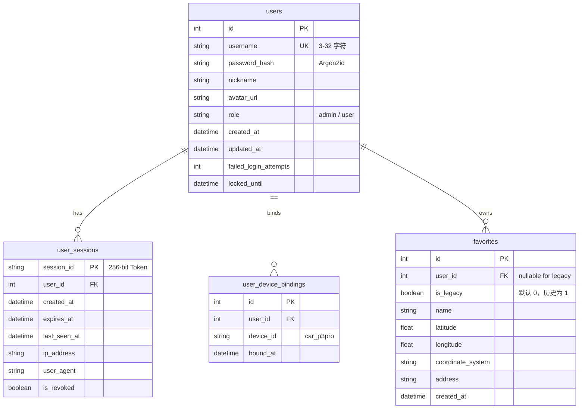

# MyYaris 用户账户系统架构、API 契约与平滑迁移方案

> **文件版本**：V1.0  
> **编写日期**：2026-10-13  
> **当前状态**：后端已完成开发与 R9000P 生产部署（提交 `0609751`），自动化测试 133/133 全绿通过。  
> **客户端状态说明**：严格遵循用户要求，**未对 `ios_app/`、`car_app/` 及 iOS 快捷指令进行任何修改**。当前后端开启了过渡期兼容支持，现有手机端继续正常工作，等待用户确认后再决定是否同步 iOS 端。

---

## 一、 系统架构与设计理念

### 1.1 背景与设计动机
早期 MyYaris 采用基于环境变量固化预设 Token（`PHONE_TOKEN`）的简单认证机制。为满足多用户管理、账号安全、车主权限管控以及个性化收藏等需求，本次重构将认证系统从静态 Token 全面升级为现代关系型账户与持久化会话机制（Argon2id + SQLite 会话存储 + HttpOnly Cookie / Dynamic Bearer Token）。

### 1.2 核心安全原则与职责分工
1. **密码学安全（Argon2id）**：
   - 采用 OWASP 密码存储指南最高推荐的 **Argon2id** 算法 (`argon2-cffi`)。
   - 参数配置：`time_cost=3`，`memory_cost=65536`（64 MB 内存消耗），`parallelism=4`，`hash_len=32`，具备极强的抗 GPU/ASIC 暴破能力。
   - 数据库中仅持久化带有安全 Salt 与工作因子的密码散列字符串，杜绝明文或可逆加密。

2. **暴力破解防御（防撞库与枚举）**：
   - 单账号连续 5 次登录凭据错误后，系统自动触发 15 分钟账户冷却锁定（`locked_until` 字段），并清空临时错误计数，防御在线字典撞库攻击。

3. **双模式会话体系（Web Cookie & Native Bearer）**：
   - 登录成功后在服务端 `user_sessions` 表持久化 256 位高熵 Session 随机串（`secrets.token_urlsafe(32)`），默认有效期 30 天。
   - **Cookie 模式**：通过 `Set-Cookie: myyaris_session=...; HttpOnly; SameSite=Lax; Path=/; Max-Age=2592000` 下发，防止客户端 XSS 窃取 Cookie。
   - **Bearer 模式**：响应体同时返回 `session_token`，客户端可在 HTTP 请求头中携带 `Authorization: Bearer <session_token>`，无缝兼容不依赖 Cookie 的原生客户端或自动化脚本。
   - **修改密码联动注销**：用户修改密码成功后，系统自动注销该用户除当前操作之外的所有其他活跃 Session，确保安全收敛。

4. **严格的 SSRF 防御与头像安全上传**：
   - **URL 外部头像**：校验 URL 合法性，禁止 `localhost`、`127.0.0.1`、IPv6 回环/私网地址；并通过 DNS 解析真实 IP，严格阻断解析到 RFC1918 内网私有地址（`10.0.0.0/8`, `172.16.0.0/12`, `192.0.2.20/16`）、运营商 CGNAT 地址以及公有云元数据服务地址（`169.254.169.254`）。
   - **本地文件上传**：限制格式仅允许 PNG、JPEG、WebP；限制大小上限 2MB；严格校验文件头部 Magic Bytes 二进制签名（防止扩展名伪造）；保存文件名重命名为随机 UUID，阻断路径遍历漏洞。

5. **车机控制 RBAC 授权与设备绑定**：
   - 区分平台用户与车主操作权限。普通用户注册后默认 `role="user"` 且 `has_device_control=False`。
   - 未绑定目标车辆控制权的用户，禁止向车机派发导航任务（`/api/v1/destinations`）、禁止发送音乐播控指令（`/api/v1/music/control`）及连接音乐实时 WebSocket。
   - 仅管理员通过 `/api/v1/auth/users/{user_id}/device-binding` 明确授权后，该用户才拥有控车权限。

6. **首个管理员安全初始化闭环（Bootstrap Admin）**：
   - 当系统没有任何用户时，开放 `POST /api/v1/auth/bootstrap-admin` 接口，允许创建系统首个管理员并直接赋予控车权限。
   - 只要数据库中存在至少 1 个用户，该接口永久关闭并返回 `403 Forbidden`。

7. **网易云车机多租户保护**：
   - 车载音响所连接的网易云音乐 VIP 账号属于车主或车机公共配置。
   - 二维码扫码登录、Cookie 手动导入、注销登录以及清理音频缓存等管理接口，严格限制仅管理员或传统 `PHONE_TOKEN` 可操作。
   - 普通用户调用 `/api/v1/music/netease/login/status` 仅能看到 `{"logged_in": true}` 布尔状态，脱敏并隐藏管理员网易云 UID 与昵称。

8. **收藏夹多租户隔离与旧数据平滑兼容**：
   - `favorites` 数据表扩展 `user_id`（关联 `users.id`）与 `is_legacy`（布尔标记）字段。
   - 系统启动时通过迁移程序将历史既有收藏数据自动打标为 `is_legacy=1` 并保留为共享旧数据池。
   - 传统 `PHONE_TOKEN` 用户继续读写旧数据池，保持完全向下兼容；登录用户仅能读写属于自己 `user_id` 的独立收藏夹。

---

## 二、 数据库表结构与平滑迁移

数据库迁移由 `app/repositories/migrations.py` 在应用启动时（FastAPI lifespan）自动幂等执行，无须人工编写 SQL 脚本或中断服务。



---

## 三、 API 接口契约说明

### 3.1 认证与用户管理接口列表

| 路径 | 方法 | 鉴权要求 | 说明 |
| :--- | :---: | :---: | :--- |
| `/api/v1/auth/bootstrap-admin` | `POST` | 开放（仅系统无用户时可用） | 初始化系统首位管理员 |
| `/api/v1/auth/register` | `POST` | 开放 | 普通用户注册（默认角色 user，无控车权） |
| `/api/v1/auth/login` | `POST` | 开放 | 用户登录，植入 Cookie 并返回 Session Token |
| `/api/v1/auth/logout` | `POST` | 需登录 | 注销当前会话（清理服务端 Session 及客户端 Cookie） |
| `/api/v1/auth/me` | `GET` | 需登录 / 支持旧Token | 获取当前登录用户画像及控车权限 |
| `/api/v1/auth/profile` | `PUT` | 需登录 | 修改昵称、头像 URL（含严格 SSRF 校验） |
| `/api/v1/auth/change-password` | `POST` | 需登录 | 修改密码，使所有其他活跃 Session 失效 |
| `/api/v1/auth/avatar/upload` | `POST` | 需登录 | 二进制上传头像图片（PNG/JPEG/WebP，<=2MB） |
| `/api/v1/auth/avatar/{filename}` | `GET` | 开放 | 获取已保存的静态头像文件 |
| `/api/v1/auth/users` | `GET` | 仅管理员 | 列出系统所有注册用户 |
| `/api/v1/auth/users/{user_id}/device-binding` | `POST` | 仅管理员 | 绑定或解绑指定用户的控车权限 |
| `/api/v1/auth/users/{user_id}/role` | `PUT` | 仅管理员 | 修改指定用户的角色（`admin` / `user`） |

---

### 3.2 详细接口请求与响应示例

#### 1. 系统管理员初始化 (`POST /api/v1/auth/bootstrap-admin`)
- **请求体**：
  ```json
  {
    "username": "myyaris-user",
    "password": "SecurePassword123!",
    "nickname": "维护者",
    "avatar_url": "https://example.com/avatar.png"
  }
  ```
- **成功响应 (`201 Created`)**：
  ```json
  {
    "id": 1,
    "username": "myyaris-user",
    "nickname": "维护者",
    "avatar_url": "https://example.com/avatar.png",
    "role": "admin",
    "has_device_control": true,
    "created_at": "2026-10-13T11:00:00Z"
  }
  ```
- **重复调用响应 (`403 Forbidden`)**：
  ```json
  {
    "detail": "Admin bootstrap is only allowed when no users exist"
  }
  ```

#### 2. 普通用户注册 (`POST /api/v1/auth/register`)
- **请求体**：
  ```json
  {
    "username": "passenger_bob",
    "password": "BobPassword456!",
    "nickname": "Bob"
  }
  ```
- **成功响应 (`201 Created`)**：
  ```json
  {
    "id": 2,
    "username": "passenger_bob",
    "nickname": "Bob",
    "avatar_url": null,
    "role": "user",
    "has_device_control": false,
    "created_at": "2026-10-13T11:05:00Z"
  }
  ```

#### 3. 用户登录 (`POST /api/v1/auth/login`)
- **请求体**：
  ```json
  {
    "username": "myyaris-user",
    "password": "SecurePassword123!"
  }
  ```
- **响应头**：
  ```http
  Set-Cookie: myyaris_session=s_e9a18f2...; Max-Age=2592000; Path=/; SameSite=lax; HttpOnly
  ```
- **响应体 (`200 OK`)**：
  ```json
  {
    "message": "Login successful",
    "session_token": "s_e9a18f2b38f8...",
    "user": {
      "id": 1,
      "username": "myyaris-user",
      "nickname": "维护者",
      "avatar_url": "https://example.com/avatar.png",
      "role": "admin",
      "has_device_control": true,
      "created_at": "2026-10-13T11:00:00Z"
    }
  }
  ```

#### 4. 获取当前信息 (`GET /api/v1/auth/me`)
- **请求头**（二选一）：
  - Cookie 方式：携带 `Cookie: myyaris_session=s_e9a18f2...`
  - Bearer 方式：携带 `Authorization: Bearer s_e9a18f2...`
  - 旧版 Token（若开启兼容）：携带 `Authorization: Bearer <PHONE_TOKEN>`
- **响应体 (`200 OK`)**：
  ```json
  {
    "id": 1,
    "username": "myyaris-user",
    "nickname": "维护者",
    "avatar_url": "https://example.com/avatar.png",
    "role": "admin",
    "has_device_control": true,
    "created_at": "2026-10-13T11:00:00Z"
  }
  ```

#### 5. 头像文件安全上传 (`POST /api/v1/auth/avatar/upload`)
- **请求类型**：`multipart/form-data`
- **参数**：`file`: 图片二进制流
- **响应体 (`200 OK`)**：
  ```json
  {
    "avatar_url": "/api/v1/auth/avatar/avatar_d98f7c10b1.png",
    "message": "Avatar uploaded successfully"
  }
  ```

#### 6. 管理员设备控制权绑定 (`POST /api/v1/auth/users/{user_id}/device-binding`)
- **请求头**：管理员 Session
- **请求体**：
  ```json
  {
    "device_id": "car_p3pro",
    "enabled": true
  }
  ```
- **响应体 (`200 OK`)**：
  ```json
  {
    "message": "Device binding updated successfully",
    "user_id": 2,
    "device_id": "car_p3pro",
    "has_device_control": true
  }
  ```

---

## 四、 业务模块受权与隔离策略

| 模块 / 接口 | 普通用户 (`user`, 未绑定设备) | 普通用户 (`user`, 已绑定设备) | 管理员 (`admin`) | 传统 `PHONE_TOKEN`（过渡期） |
| :--- | :---: | :---: | :---: | :---: |
| **收藏夹查看/添加/删除** | 仅访问自身收藏 | 仅访问自身收藏 | 访问自身收藏 | 访问共享旧数据池 (`is_legacy=1`) |
| **网易云播放/音量/下一首** | 403 无权控制 | 允许操作 | 允许操作 | 允许操作 |
| **车机导航下发** | 403 无权控制 | 允许操作 | 允许操作 | 允许操作 |
| **网易云扫码登录/Cookie导入** | 403 无权管理 | 403 无权管理 | 允许操作 | 允许操作 |
| **网易云状态查询** | 仅显示脱敏 logged_in | 仅显示脱敏 logged_in | 显示完整 UID/昵称 | 显示完整 UID/昵称 |

---

## 五、 部署与测试验证报告

1. **代码提交记录**：
   - 后端仓库提交：`0609751` (`feat(auth): implement user account system with Argon2id, session cookies, and RBAC`)
2. **R9000P 运行状态**：
   - 服务 Unit：`myyaris.service`
   - 主进程 PID：`1569122`（uvicorn worker 正常服务中）
   - 依赖库：虚拟环境已成功安装 `argon2-cffi>=23.1.0`
3. **自动化测试套件结果**：
   - 执行指令：`pytest`
   - 测试通过数：**133 项测试全部通过（133 passed, 0 failed）**，用时 12.06s。
   - 新增专项目测试：`tests/test_auth_and_user.py`（14 个深度测试场景，覆盖 Argon2id、会话生命周期、防暴力破解锁定、密码修改注销、头像 SSRF 防御、文件二进制合法性、多租户收藏隔离、RBAC 控车权限等）。

---

## 六、 客户端迁移建议与后续决策

根据既定指示，当前仅完成后端能力的建设与部署，**未触碰客户端代码**。目前系统已启用 `ENABLE_LEGACY_TOKEN_AUTH=True`，现行 iPhone 客户端及车机可无缝继续运行。

后续若决定升级 iOS 客户端，推荐按以下步骤推进：
1. **iOS 客户端新增登录与注册界面**：支持用户名/密码登录及注册，本地存储 Session Token 或通过 CookieJar 管理 Cookie。
2. **鉴权头适配**：由原先静态拼装 `Authorization: Bearer <PHONE_TOKEN>` 改为优先附带 `Authorization: Bearer <session_token>`。
3. **收藏夹自动归属迁移**：在 iOS 端提供「将旧共享收藏同步至当前用户」的可选引导按钮。
4. **废弃旧 Token**：当所有常用设备完成升级后，在后端配置中将 `ENABLE_LEGACY_TOKEN_AUTH` 设置为 `False`，彻底关闭静态 Token 认证通道。
