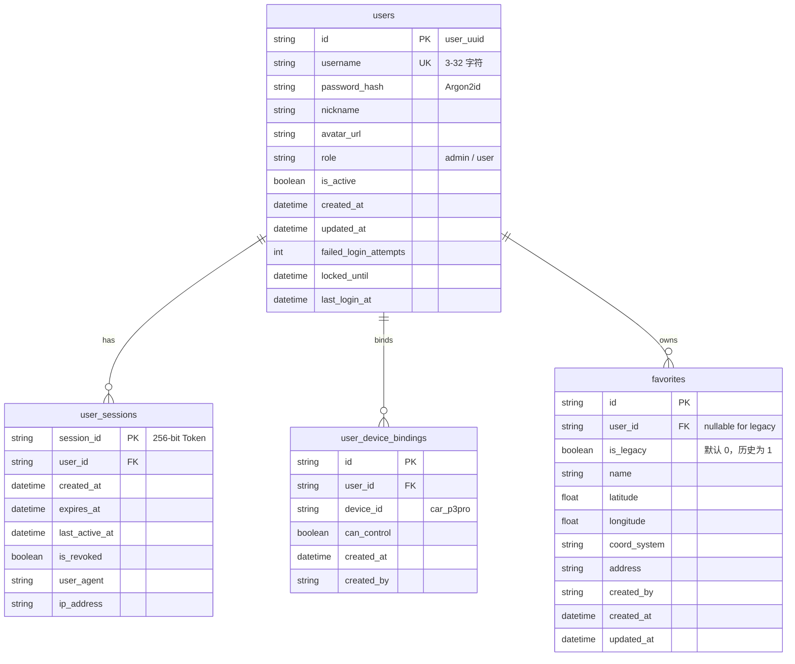

# MyYaris 用户账户系统架构、API 契约与平滑迁移方案

> **文件版本**：V1.1  
> **编写日期**：2026-10-13  
> **当前状态**：后端已完成加固与生产部署（提交 `d8831fe`），自动化测试 136/136 全绿通过。  
> **客户端状态说明**：严格遵守未授权约束，**未对 `ios_app/`、`car_app/` 及 iOS 快捷指令进行任何修改**。当前后端开启了过渡期兼容支持（`ENABLE_LEGACY_TOKEN_AUTH=True`），现有手机端与车机继续正常工作，等待用户确认后再决定是否同步 iOS 端。

---

## 一、 系统架构与安全设计

### 1.1 背景与设计动机
早期 MyYaris 采用基于环境变量固化预设 Token（`PHONE_TOKEN`）的简单认证机制。为满足多用户管理、账号安全、车主权限管控以及个性化收藏等需求，本次重构将认证系统从静态预设 Token 升级为现代关系型账户与持久化会话机制（Argon2id 密码哈希 + SQLite 会话存储 + HttpOnly Cookie / Dynamic Bearer Token）。

> **说明**：系统废除的是用户在客户端界面「手动长期硬编码填入固定 Token」，底层通信仍然依赖由服务端动态生成、具有时效性且支持注销的高熵临时会话凭据（Session Token）。

---

## 1.2 核心安全机制与边界定义

1. **密码学存储（Argon2id）**：
   - 采用 Argon2id 算法（`argon2-cffi`）。
   - 生产参数：`time_cost=2`，`memory_cost=19456`（19 MiB），`parallelism=1`，`hash_len=32`。
   - 数据库仅存储带有 Salt 与工作因子的散列串，不存储明文密码。

2. **登录失败防护与临时锁定**：
   - 单账号连续 5 次登录凭据错误后，系统触发 15 分钟账户冷却锁定（`locked_until` 字段），并重置临时错误计数，限制针对已知账号的在线暴力猜测。

3. **双模式会话体系（Web Cookie & Native Bearer）**：
   - 登录成功后在服务端 `user_sessions` 表持久化 256 位高熵 Session 随机串（`secrets.token_urlsafe(32)`），默认有效期 30 天。
   - **Cookie 模式**：通过 `Set-Cookie: myyaris_session=...; HttpOnly; SameSite=Lax; Path=/; Max-Age=2592000` 下发。现网生产环境启用 `COOKIE_SECURE=True`。
   - **Bearer 模式**：响应体同时返回 `session_id`，原生 Native App 可在请求头中携带 `Authorization: Bearer <session_id>`，不依赖 Cookie。
   - **修改密码联动注销**：用户修改密码成功后，系统自动注销该用户除当前操作之外的所有其他活跃 Session，促使其他客户端重新认证。

4. **Cookie 认证的 CSRF 与 Origin 防护**：
   - `SameSite=Lax` 仅限制了部分跨站请求场景，不能覆盖所有上下文。为此，系统对所有**依赖 Cookie 认证的状态变更操作**（POST、PUT、PATCH、DELETE）强制执行防跨站伪造校验：
     1. **Origin / Referer 校验**：若请求携带 `Origin`，验证其与请求 Host 或信任白名单匹配。
     2. **双提交 CSRF Token 校验**：登录成功时下发 JavaScript 可读的 `myyaris_csrf` Cookie 及响应字段。基于 Cookie 认证的写请求必须在请求头中携带 `X-CSRF-Token`，服务端验证其与 Cookie / 会话派生令牌的一致性。
     3. **Bearer 原生请求豁免**：以 `Authorization: Bearer` 方式调用的原生 API 请求由于浏览器不会自动携带自定义授权头，不受此类跨站表单伪造影响，保持原生调用的连贯性。

5. **受控的首次管理员初始化（Bootstrap Admin）**：
   - 接口：`POST /api/v1/auth/bootstrap-admin`。
   - **访问控制**：接口必须受受控开关 `ENABLE_BOOTSTRAP_ADMIN=True` 及服务端预设的 `ADMIN_TOKEN`（`require_legacy_admin`）保护，拒绝未授权访问，严格禁止 Phone Token 或 Car Token 调用。
   - **密码由调用方提供**：代码中不硬编码或自动生成默认密码，密码完全由调用方显式提交。
   - **并发事务与锁保护**：采用进程级线程锁与数据库检查，避免并发竞态导致重复创建。
   - **明确的状态规则**：仅在系统中没有任何 `role='admin'` 用户时允许初始化。若系统中已有普通用户（如提前注册的账号），持有合法 `ADMIN_TOKEN` 的管理员依然可以执行初始化，系统将自动提权对应账号为管理员并注销旧会话。一旦系统中存在管理员，该接口永久关闭并返回 `403 Forbidden`。

6. **权限最小化与设备端凭据隔离**：
   - 车机物理操作通道（长轮询任务 `/devices/{id}/tasks/next`、下发完成确认 `/tasks/{id}/ack`、音乐播控拉取 `/music/control/command/next`）仅对物理车机设备（`role='car'`）或使用硬编码 `ADMIN_TOKEN` 的系统维护通道开放。
   - 通过 Web/App 注册的人机管理员账号（`user.role='admin'`）无法冒充车机硬件去拉取车机任务队列（返回 `403 Forbidden`），防止人机账号干扰设备调度。
   - 任何 API 接口均不向前端或普通管理员暴露底层车机硬件密钥（`CAR_TOKEN`）或 `Device.token_hash`。

7. **用户设备权限绑定（RBAC 覆盖）**：
   - 普通用户注册默认 `role="user"` 且 `has_device_control=False`。
   - 未绑定车辆控制权的用户，禁止连接实时播控 WebSocket（`/ws/music`）、禁止发送控制指令（`/api/v1/music/control/command`）、禁止查询车机实时播放状态（`/api/v1/music/control/status`）、禁止查询播控指令状态（`/api/v1/music/control/command/{id}`）、禁止查询导航任务（`/tasks/{id}`）及目的地请求（`/destinations/{id}`）。
   - 必须由管理员在后台调用 `/api/v1/auth/users/{user_id}/device-binding` 授权后，普通用户方可获取控车权限。

8. **头像安全上传与解码转码**：
   - **本地图片上传**：
     - 使用 Pillow 图像库实际解码文件流，验证图像数据有效性；
     - 检查尺寸与像素阈值（最小 16x16，最大 4096x4096，总像素不超过 16 MP）；
     - 将图像内存数据重新转码保存为纯净 PNG 或 JPEG，剥离原始文件可能携带的 EXIF 元数据、ICC Profile 或非图像附带数据；
     - 文件大小限制为 2MB；
     - 文件名采用随机 UUID 重命名，路径遍历防护。
   - **外部头像 URL**：
     - **服务端不主动发起 HTTP 请求抓取外部 URL**，杜绝服务器代拉取引入的 SSRF 风险；
     - 外部链接仅作为客户端展示用字段进行格式检查，限制必须为 `https://` 协议，拒绝内网域名与 IP 地址。

9. **收藏夹多租户隔离与旧数据平滑兼容**：
   - `favorites` 表增加 `user_id` 与 `is_legacy` 列。
   - 系统启动时通过迁移程序将历史既有收藏数据打标为 `is_legacy=1`，保留为共享旧数据池。
   - 传统 `PHONE_TOKEN` 用户继续读写旧数据池，保持完全向下兼容；登录用户仅能读写属于自己 `user_id` 的独立收藏夹。

---

## 二、 数据库表结构



---

## 三、 API 接口契约说明

### 3.1 接口列表

| 路径 | 方法 | 鉴权要求 | 说明 |
| :--- | :---: | :---: | :--- |
| `/api/v1/auth/bootstrap-admin` | `POST` | 需合法 `ADMIN_TOKEN` | 初始化首位管理员（仅当系统中无 admin 时开放） |
| `/api/v1/auth/register` | `POST` | 开放 | 普通用户注册（默认角色 user，无控车权） |
| `/api/v1/auth/login` | `POST` | 开放 | 用户登录，写入 Session/CSRF Cookie 并返回动态会话标识 |
| `/api/v1/auth/logout` | `POST` | 需登录（Cookie 写操作需 CSRF） | 注销会话并清理 Cookie |
| `/api/v1/auth/me` | `GET` | 需登录 / 支持过渡期 Token | 获取当前用户画像及控车权限状态 |
| `/api/v1/auth/profile` | `PATCH` | 需登录（Cookie 写操作需 CSRF） | 更新昵称、展示头像 URL |
| `/api/v1/auth/change-password` | `POST` | 需登录（Cookie 写操作需 CSRF） | 修改密码并吊销其他所有活跃会话 |
| `/api/v1/auth/avatar` | `POST` | 需登录（Cookie 写操作需 CSRF） | 上传头像（Pillow 解码转码，剥离元数据，<=2MB） |
| `/api/v1/auth/avatar/{filename}` | `GET` | 开放 | 安全读取头像图片（路径穿越保护） |
| `/api/v1/auth/users` | `GET` | 仅管理员 | 列出系统所有注册用户 |
| `/api/v1/auth/users/{user_id}/device-binding` | `POST` | 仅管理员（Cookie 写操作需 CSRF） | 授权或撤销用户的车辆设备控制权 |
| `/api/v1/auth/users/{user_id}/role` | `PATCH` | 仅管理员（Cookie 写操作需 CSRF） | 修改指定用户的角色（`admin` / `user`） |

---

### 3.2 典型调用示例

#### 1. 管理员初始化 (`POST /api/v1/auth/bootstrap-admin`)
- **请求头**：
  ```http
  Authorization: Bearer <ADMIN_TOKEN>
  ```
- **请求体**：
  ```json
  {
    "username": "admin",
    "password": "UserProvidedAdminPassword123!",
    "nickname": "Admin"
  }
  ```
- **响应体 (`201 Created`)**：
  ```json
  {
    "id": "user_1a2b3c4d5e6f",
    "username": "admin",
    "nickname": "Admin",
    "avatar_url": null,
    "role": "admin",
    "is_active": true,
    "has_device_control": true,
    "created_at": "2026-10-13T11:00:00Z",
    "updated_at": "2026-10-13T11:00:00Z",
    "last_login_at": null
  }
  ```

#### 2. 用户登录 (`POST /api/v1/auth/login`)
- **请求体**：
  ```json
  {
    "username": "admin",
    "password": "UserProvidedAdminPassword123!"
  }
  ```
- **响应头**：
  ```http
  Set-Cookie: myyaris_session=s_9f8e...; Max-Age=2592000; Path=/; SameSite=lax; HttpOnly; Secure
  Set-Cookie: myyaris_csrf=csrf_abc123...; Max-Age=2592000; Path=/; SameSite=lax; Secure
  ```
- **响应体 (`200 OK`)**：
  ```json
  {
    "code": 200,
    "message": "Login successful",
    "session_id": "s_9f8e7d6c5b4a...",
    "csrf_token": "csrf_abc123...",
    "token_type": "bearer",
    "expires_at": "2026-11-12T11:00:00Z",
    "user": {
      "id": "user_1a2b3c4d5e6f",
      "username": "admin",
      "nickname": "Admin",
      "avatar_url": null,
      "role": "admin",
      "is_active": true,
      "has_device_control": true,
      "created_at": "2026-10-13T11:00:00Z",
      "updated_at": "2026-10-13T11:00:00Z",
      "last_login_at": "2026-10-13T11:10:00Z"
    }
  }
  ```

#### 3. 基于 Cookie 的写操作（需带 CSRF 校验）
- **请求头**：
  ```http
  Cookie: myyaris_session=s_9f8e...; myyaris_csrf=csrf_abc123...
  X-CSRF-Token: csrf_abc123...
  Content-Type: application/json
  ```
- **请求体**：
  ```json
  {
    "name": "公司",
    "address": "东京都港区...",
    "latitude": 35.6586,
    "longitude": 139.7454,
    "coord_system": "wgs84"
  }
  ```

---

## 四、 部署状态与测试验证

1. **代码提交记录**：
   - 后端仓库当前提交：`d8831fe` (`fix(auth): harden bootstrap admin with legacy token check, add CSRF defense, and sanitize avatar with PIL`)
2. **服务器运行状态**：
   - 服务 Unit：`myyaris.service`
   - 主进程 PID：`1578616`（Uvicorn 正常监听中）
   - 车机心跳：已正常接收来自 Ottocast P3 Pro（Tailscale IP `<CAR_TAILSCALE_IP>`）的播控状态上报（`200 OK`）。
3. **自动化测试套件结果**：
   - 实际执行全量测试：
     ```text
     tests/test_auth_and_user.py .................                            [ 12%]
     tests/test_auto_input.py .............                                   [ 22%]
     tests/test_concurrency_and_wal.py ..                                     [ 23%]
     tests/test_destinations.py .............                                 [ 33%]
     tests/test_favorites.py .......                                          [ 38%]
     tests/test_health_and_auth.py ...                                        [ 40%]
     tests/test_monotonic_acks.py ...                                         [ 42%]
     tests/test_music_control.py .....                                        [ 46%]
     tests/test_music_netease.py .............                                [ 55%]
     tests/test_music_stream.py ....                                          [ 58%]
     tests/test_nominatim.py ..........                                       [ 66%]
     tests/test_plus_code.py ................                                 [ 77%]
     tests/test_supersede_and_expiry.py ...                                   [ 80%]
     tests/test_tasks_longpoll.py ..                                          [ 81%]
     tests/test_v2_contract.py ...............                                [ 92%]
     tests/test_v2_goal4.py ...                                               [ 94%]
     tests/test_voice_and_ssrf.py .......                                     [100%]
     ======================= 136 passed, 5 warnings in 12.71s =======================
     ```
   - 136 项测试全部通过（0 失败）。

---

## 五、 客户端过渡事实与明确边界

1. **过渡期兼容性事实**：
   - 当前后端配置保持 `ENABLE_LEGACY_TOKEN_AUTH=True`。
   - 现有 iPhone 客户端携带静态 `PHONE_TOKEN` 仍可继续调用已有业务接口（目的地解析、播控、共享旧收藏池）。
   - 车机客户端携带 `CAR_TOKEN` 维持原有长轮询与心跳通路不变。
2. **明确边界与已知假定**：
   - 本次仅为后端基础设施就绪，**尚未改造任何 iOS 客户端界面与网络请求**。
   - 头像防伪依赖 Pillow 库解码与重编码，服务端不代理下载任何外部图片链接。
   - CSRF 防御针对 Cookie 认证路径，基于 Bearer 令牌的原生客户端不受 CSRF Token 头要求影响。
